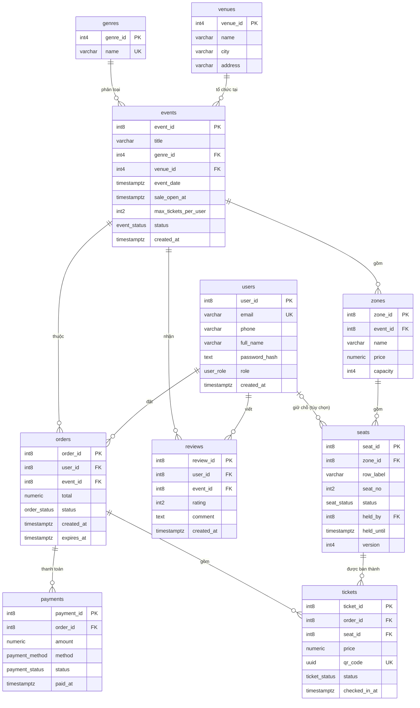

# ERD – CSDL PostgreSQL của TicketRush

> File này **được sinh tự động** từ CSDL thật bằng `node scripts/gen-erd.js` – đừng sửa tay, hãy sửa `database/schema.sql` rồi chạy lại script.

PostgreSQL là nguồn dữ liệu chuẩn (10 bảng, 12 khóa ngoại, 1 trigger). Cloud Firestore chỉ là bản sao phục vụ realtime/offline (xem phần cuối).

## 1. Sơ đồ quan hệ thực thể

Ảnh để chèn báo cáo: [erd.png](erd.png) · [erd.svg](erd.svg) (dựng từ khối Mermaid trên).

Ghi chú ký hiệu: `||` đúng một, `o{` không hoặc nhiều, `|o` không hoặc một (khóa ngoại cho phép NULL).

## 2. Từ điển dữ liệu

### events

| Cột | Kiểu | Null | Mặc định | Ghi chú |
|---|---|---|---|---|
| event_id | int8 | NOT NULL | `nextval('events_event_id_seq'::regclass)` | PK |
| title | varchar(200) | NOT NULL |  |  |
| genre_id | int4 | NOT NULL |  | FK → genres |
| venue_id | int4 | NOT NULL |  | FK → venues |
| event_date | timestamptz | NOT NULL |  |  |
| sale_open_at | timestamptz | NOT NULL |  |  |
| max_tickets_per_user | int2 | NOT NULL | `4` |  |
| status | event_status | NOT NULL | `'DRAFT'::event_status` |  |
| created_at | timestamptz | NOT NULL | `now()` |  |

**Ràng buộc / chỉ mục khác**

- `chk_max_tickets`: `CHECK (((max_tickets_per_user >= 1) AND (max_tickets_per_user <= 10)))`
- `chk_sale_before_event`: `CHECK ((sale_open_at < event_date))`
- `idx_events_date`: `CREATE INDEX idx_events_date ON public.events USING btree (event_date)`
- `idx_events_genre`: `CREATE INDEX idx_events_genre ON public.events USING btree (genre_id)`
- `idx_events_venue`: `CREATE INDEX idx_events_venue ON public.events USING btree (venue_id)`

### genres

| Cột | Kiểu | Null | Mặc định | Ghi chú |
|---|---|---|---|---|
| genre_id | int4 | NOT NULL | `nextval('genres_genre_id_seq'::regclass)` | PK |
| name | varchar(50) | NOT NULL |  | UNIQUE |

### orders

| Cột | Kiểu | Null | Mặc định | Ghi chú |
|---|---|---|---|---|
| order_id | int8 | NOT NULL | `nextval('orders_order_id_seq'::regclass)` | PK |
| user_id | int8 | NOT NULL |  | FK → users |
| event_id | int8 | NOT NULL |  | FK → events |
| total | numeric(14,0) | NOT NULL | `0` |  |
| status | order_status | NOT NULL | `'PENDING'::order_status` |  |
| created_at | timestamptz | NOT NULL | `now()` |  |
| expires_at | timestamptz | NOT NULL | `(now() + '00:10:00'::interval)` |  |

**Ràng buộc / chỉ mục khác**

- `chk_total`: `CHECK ((total >= (0)::numeric))`
- `idx_orders_user_event`: `CREATE INDEX idx_orders_user_event ON public.orders USING btree (user_id, event_id)`

### payments

| Cột | Kiểu | Null | Mặc định | Ghi chú |
|---|---|---|---|---|
| payment_id | int8 | NOT NULL | `nextval('payments_payment_id_seq'::regclass)` | PK |
| order_id | int8 | NOT NULL |  | FK → orders (ON DELETE CASCADE) |
| amount | numeric(14,0) | NOT NULL |  |  |
| method | payment_method | NOT NULL |  |  |
| status | payment_status | NOT NULL | `'PENDING'::payment_status` |  |
| paid_at | timestamptz | null |  |  |

**Ràng buộc / chỉ mục khác**

- `chk_amount`: `CHECK ((amount > (0)::numeric))`
- `chk_paid_at`: `CHECK (((status = 'SUCCESS'::payment_status) <= (paid_at IS NOT NULL)))`
- `idx_payments_order`: `CREATE INDEX idx_payments_order ON public.payments USING btree (order_id)`
- `uq_success_payment_per_order`: `CREATE UNIQUE INDEX uq_success_payment_per_order ON public.payments USING btree (order_id) WHERE (status = 'SUCCESS'::payment_status)`

### reviews

| Cột | Kiểu | Null | Mặc định | Ghi chú |
|---|---|---|---|---|
| review_id | int8 | NOT NULL | `nextval('reviews_review_id_seq'::regclass)` | PK |
| user_id | int8 | NOT NULL |  | FK → users |
| event_id | int8 | NOT NULL |  | FK → events (ON DELETE CASCADE) |
| rating | int2 | NOT NULL |  |  |
| comment | text | null |  |  |
| created_at | timestamptz | NOT NULL | `now()` |  |

**Ràng buộc / chỉ mục khác**

- `chk_rating`: `CHECK (((rating >= 1) AND (rating <= 5)))`
- `reviews_user_id_event_id_key`: `UNIQUE (user_id, event_id)`
- `idx_reviews_event`: `CREATE INDEX idx_reviews_event ON public.reviews USING btree (event_id)`

### seats

| Cột | Kiểu | Null | Mặc định | Ghi chú |
|---|---|---|---|---|
| seat_id | int8 | NOT NULL | `nextval('seats_seat_id_seq'::regclass)` | PK |
| zone_id | int8 | NOT NULL |  | FK → zones (ON DELETE CASCADE) |
| row_label | varchar(5) | NOT NULL |  |  |
| seat_no | int2 | NOT NULL |  |  |
| status | seat_status | NOT NULL | `'AVAILABLE'::seat_status` |  |
| held_by | int8 | null |  | FK → users |
| held_until | timestamptz | null |  |  |
| version | int4 | NOT NULL | `0` |  |

**Ràng buộc / chỉ mục khác**

- `chk_hold`: `CHECK ((((status = 'HELD'::seat_status) AND (held_by IS NOT NULL) AND (held_until IS NOT NULL)) OR ((status <> 'HELD'::seat_status) AND (held_by IS NULL) AND (held_until IS NULL))))`
- `seats_zone_id_row_label_seat_no_key`: `UNIQUE (zone_id, row_label, seat_no)`
- `idx_seats_zone_status`: `CREATE INDEX idx_seats_zone_status ON public.seats USING btree (zone_id, status)`

### tickets

| Cột | Kiểu | Null | Mặc định | Ghi chú |
|---|---|---|---|---|
| ticket_id | int8 | NOT NULL | `nextval('tickets_ticket_id_seq'::regclass)` | PK |
| order_id | int8 | NOT NULL |  | FK → orders (ON DELETE CASCADE) |
| seat_id | int8 | NOT NULL |  | FK → seats |
| price | numeric(12,0) | NOT NULL |  |  |
| qr_code | uuid | NOT NULL | `gen_random_uuid()` | UNIQUE |
| status | ticket_status | NOT NULL | `'VALID'::ticket_status` |  |
| checked_in_at | timestamptz | null |  |  |

**Ràng buộc / chỉ mục khác**

- `chk_checkin`: `CHECK (((status = 'CHECKED_IN'::ticket_status) = (checked_in_at IS NOT NULL)))`
- `chk_ticket_price`: `CHECK ((price >= (0)::numeric))`
- `idx_tickets_order`: `CREATE INDEX idx_tickets_order ON public.tickets USING btree (order_id)`
- `uq_active_ticket_per_seat`: `CREATE UNIQUE INDEX uq_active_ticket_per_seat ON public.tickets USING btree (seat_id) WHERE (status <> 'CANCELLED'::ticket_status)`

### users

| Cột | Kiểu | Null | Mặc định | Ghi chú |
|---|---|---|---|---|
| user_id | int8 | NOT NULL | `nextval('users_user_id_seq'::regclass)` | PK |
| email | varchar(255) | NOT NULL |  | UNIQUE |
| phone | varchar(15) | NOT NULL |  |  |
| full_name | varchar(100) | NOT NULL |  |  |
| password_hash | text | NOT NULL |  |  |
| role | user_role | NOT NULL | `'CUSTOMER'::user_role` |  |
| created_at | timestamptz | NOT NULL | `now()` |  |

**Ràng buộc / chỉ mục khác**

- `chk_phone`: `CHECK (((phone)::text ~ '^[0-9]{9,15}$'::text))`

### venues

| Cột | Kiểu | Null | Mặc định | Ghi chú |
|---|---|---|---|---|
| venue_id | int4 | NOT NULL | `nextval('venues_venue_id_seq'::regclass)` | PK |
| name | varchar(150) | NOT NULL |  |  |
| city | varchar(50) | NOT NULL |  |  |
| address | varchar(255) | NOT NULL |  |  |

**Ràng buộc / chỉ mục khác**

- `venues_name_city_key`: `UNIQUE (name, city)`

### zones

| Cột | Kiểu | Null | Mặc định | Ghi chú |
|---|---|---|---|---|
| zone_id | int8 | NOT NULL | `nextval('zones_zone_id_seq'::regclass)` | PK |
| event_id | int8 | NOT NULL |  | FK → events (ON DELETE CASCADE) |
| name | varchar(30) | NOT NULL |  |  |
| price | numeric(12,0) | NOT NULL |  |  |
| capacity | int4 | NOT NULL |  |  |

**Ràng buộc / chỉ mục khác**

- `chk_capacity`: `CHECK ((capacity > 0))`
- `chk_price`: `CHECK ((price >= (0)::numeric))`
- `zones_event_id_name_key`: `UNIQUE (event_id, name)`
- `idx_zones_event`: `CREATE INDEX idx_zones_event ON public.zones USING btree (event_id)`

## 3. Trigger và ràng buộc nghiệp vụ

- Trigger `ticket_rules` trên `tickets` gọi hàm `trg_ticket_rules()`: `CREATE TRIGGER ticket_rules BEFORE INSERT OR UPDATE OF seat_id, status, order_id ON public.tickets FOR EACH ROW EXECUTE FUNCTION trg_ticket_rules()`

Các chỉ mục unique một phần là tuyến phòng thủ cuối cùng chống bán trùng ghế và thanh toán trùng, kể cả khi mã ứng dụng có lỗi: `uq_active_ticket_per_seat` (mỗi ghế chỉ có tối đa một vé còn hiệu lực), `uq_success_payment_per_order` (mỗi đơn chỉ có một thanh toán thành công). Backend khóa bản ghi bằng `SELECT … FOR UPDATE` theo thứ tự users → events → seats (theo seat_id) để tránh deadlock.

## 4. Mô hình Cloud Firestore (bản sao)

| Đường dẫn | Nội dung | Nguồn từ PostgreSQL | Ai ghi |
|---|---|---|---|
| `events/{eventId}` | thông tin sự kiện, `zonesSummary` | events, zones | backend (sau COMMIT) |
| `events/{eventId}/seats/{seatId}` | trạng thái ghế, hạng, giá | seats, zones | backend |
| `validTickets/{qrCode}` | vé hợp lệ để soát offline; `checkedIn`, `checkedInAt` | tickets | backend; STAFF chỉ được cập nhật `checkedIn`/`checkedInAt` |
| `notifications/{userId}/items/{id}` | thông báo thanh toán/hủy | orders | backend |

- Firebase uid = `String(user_id)`, kèm custom claim `role` (cấp bởi `POST /api/auth/firebase-token`).
- Security Rules (`firebase/firestore.rules`): client chỉ đọc; thông báo chỉ chủ sở hữu đọc được.
- Đồng bộ một chiều PostgreSQL → Firestore sau mỗi COMMIT (lỗi chỉ ghi log; có nút "Đồng bộ" ở trang admin để dựng lại). Chiều ngược lại duy nhất là kết quả soát vé: Firestore → PostgreSQL qua `POST /api/checkin/sync` (idempotent).
