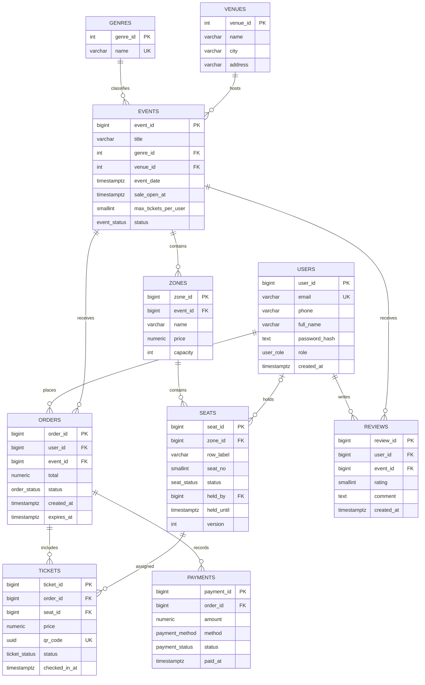

# TicketRush ERD

Schema/ERD ghi nhận toàn bộ các bảng trong `database/schema.sql`; một số bảng như `reviews` và các trường QR/check-in nằm ngoài chức năng tuần 42.

## Ràng buộc giao dịch vé

- `UNIQUE (event_id, name)` ngăn trùng tên khu vực trong cùng sự kiện.
- `UNIQUE (zone_id, row_label, seat_no)` định danh vị trí ghế.
- Partial unique index `uq_active_ticket_per_seat` chỉ cho một vé chưa hủy trên mỗi ghế.
- Trigger `ticket_rules` kiểm tra ghế thuộc đúng event và giới hạn số vé trên event.
- `chk_hold` buộc ghế `HELD` có `held_by` và `held_until`.
- `uq_success_payment_per_order` giới hạn một payment thành công cho mỗi order.

`database/schema.sql` là script tạo schema PostgreSQL. Script có `DROP TABLE ... CASCADE`; chỉ chạy trên database mới hoặc chấp nhận xóa dữ liệu.
