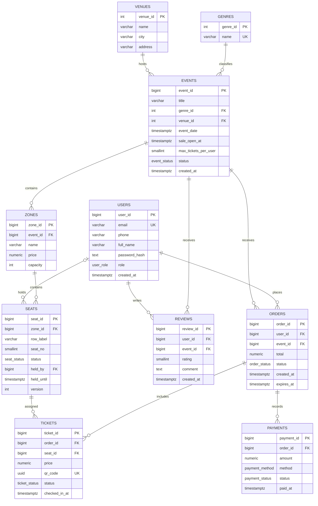

# TicketRush ERD

## PostgreSQL – Relational Schema



---

## Firestore – Document Model (ban sao realtime/offline)

```
events/{eventId}
  title, eventDate, status
  zonesSummary: { VIP: {capacity, left}, CAT1: {capacity, left}, GA: {capacity, left} }

  seats/{seatId}
    status: AVAILABLE | HELD | SOLD
    heldBy: string | null
    heldUntil: timestamp | null
    zone, row: string; number: int

  queue/{userId}
    position: int, joinedAt: timestamp, admitted: bool

validTickets/{qrCode}
  eventId, seatLabel, holderName
  checkedIn: bool, checkedInAt: timestamp | null

notifications/{userId}/items/{notifId}
  message, read, createdAt
```

### So sanh mo hinh luu tru (Data Storage)

| Tieu chi | PostgreSQL | Firestore |
|---|---|---|
| Cau truc | 10 bang chuan hoa (3NF), khoa ngoai | Collection/document, denormalized |
| Ve cua toi | 1 query JOIN 6 bang | 2+ reads/ve (validTickets + events) |
| Ghi ve moi | 1 ACID transaction | batch write nhieu document |
| Realtime | Polling / LISTEN-NOTIFY | onSnapshot push tu dong |
| Offline | Khong ho tro native | IndexedDB cache tu dong |
| Dung luong | Nho hon (chuan hoa) | Lon hon (denormalize) |
| Chi phi doc | Khong tinh theo op | ~$0.06/100k reads |
| Nhat quan | ACID serializable | Eventual (cross-doc) |

---

## Rang buoc giao dich ve (PostgreSQL)

- UNIQUE (event_id, name) tren zones
- UNIQUE (zone_id, row_label, seat_no) tren seats
- Partial unique index uq_active_ticket_per_seat
- Trigger ticket_rules: ghe thuoc dung event; gioi han max_tickets_per_user
- CHECK chk_hold: ghe HELD phai co held_by va held_until
- Partial unique index uq_success_payment_per_order

## Luong giao dich mua ve

```
BEGIN
  SELECT ... FROM users FOR UPDATE       -- khoa user
  SELECT ... FROM events FOR UPDATE      -- kiem tra ON_SALE
  SELECT ... FROM seats FOR UPDATE OF s  -- khoa ghe
  INSERT INTO orders ...
  INSERT INTO tickets ... (loop)
  UPDATE seats SET status=HELD ...
COMMIT
  bgSync -> Firestore (best-effort)
```

database/schema.sql la DDL PostgreSQL 16 day du. Script co DROP TABLE ... CASCADE; chi chay tren database moi.
